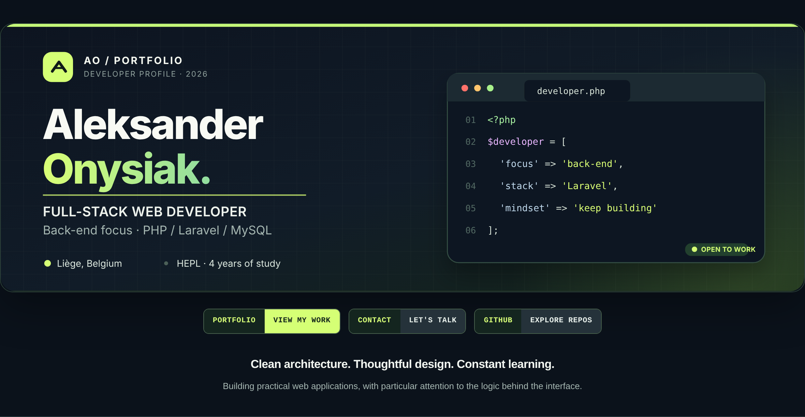
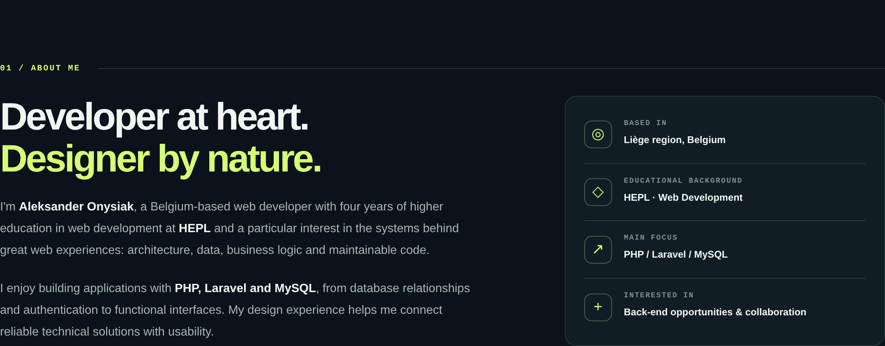
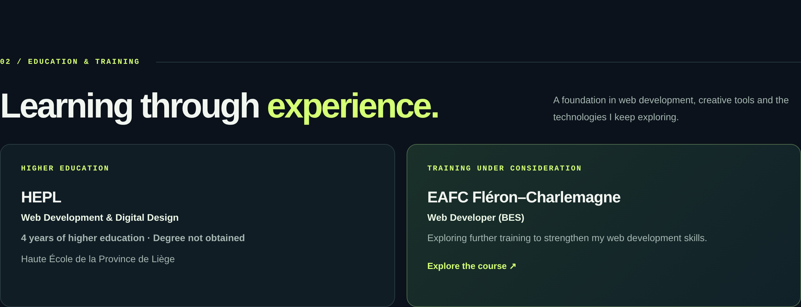
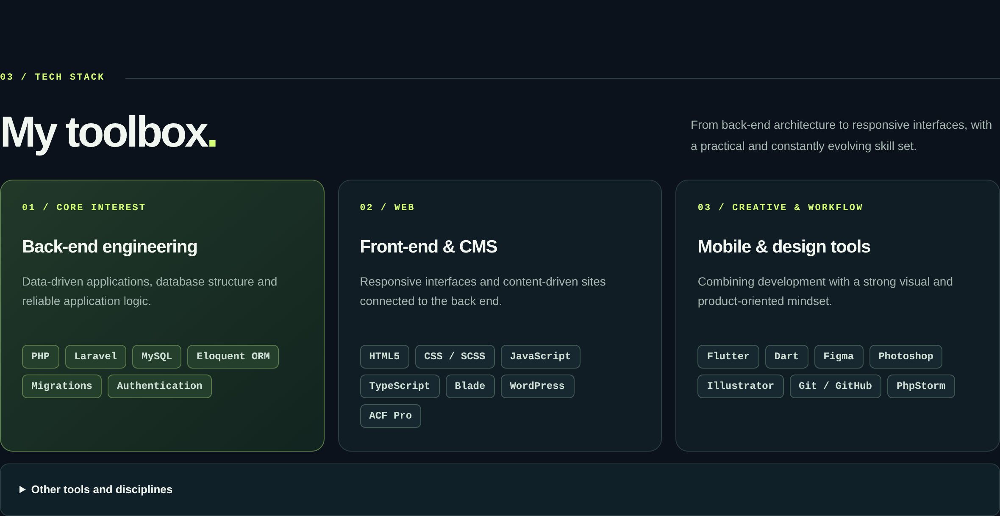
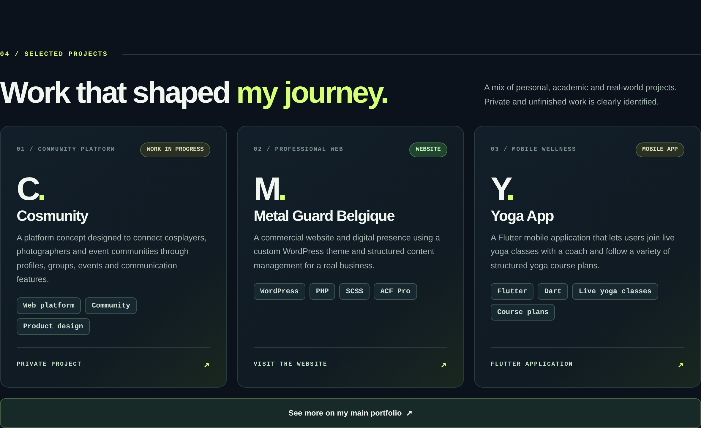
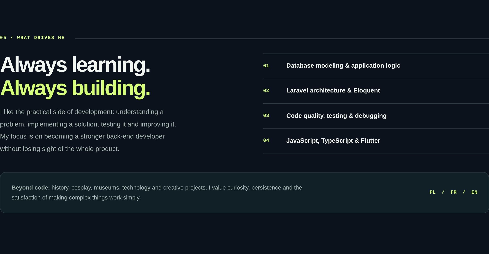
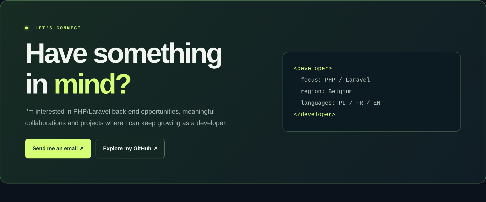
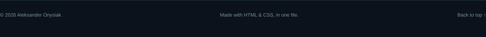

<!--
  Aleksander Onysiak — GitHub Profile README.

-->

  <a href="https://portfolio.aleksanderonysiak.be"><strong>VIEW MY PORTFOLIO</strong></a>
  &nbsp;·&nbsp;
  <a href="https://github.com/Aleksander-Onysiak?tab=repositories"><strong>GITHUB PROJECTS</strong></a>
  &nbsp;·&nbsp;
  <a href="mailto:onysaleks@gmail.com"><strong>CONTACT ME</strong></a>

<a href="https://formation-web-developer-designer.be/"><strong>Explore the EAFC Web Developer course ↗</strong></a>

  <a href="https://metalguard.be/"><strong>METAL GUARD BELGIQUE ↗</strong></a>
  &nbsp;·&nbsp;
  <a href="https://portfolio.aleksanderonysiak.be"><strong>MORE PROJECTS ↗</strong></a>

  <a href="mailto:onysaleks@gmail.com"><strong>SEND ME AN EMAIL</strong></a>
  &nbsp;·&nbsp;
  <a href="https://github.com/Aleksander-Onysiak"><strong>GITHUB</strong></a>

<strong>Accessible text version / Read my profile</strong>

### About me

I'm Aleksander Onysiak, a Belgium-based web developer with four years of higher education in web development at HEPL. I'm particularly interested in back-end development with PHP, Laravel and MySQL, from database relationships to authentication and application logic.

### Education

- **HEPL — Web Development & Digital Design:** 4 years of higher education; degree not obtained.
- **EAFC Fléron–Charlemagne — Web Developer (BES):** training under consideration.

### Tech stack

- **Back-end:** PHP, Laravel, MySQL, Eloquent ORM, migrations, authentication.
- **Front-end and CMS:** HTML5, CSS, SCSS, JavaScript, TypeScript, Blade, WordPress, ACF Pro.
- **Mobile and design:** Flutter, Dart, Figma, Photoshop, Illustrator, Git, GitHub, PhpStorm.
- **More:** Alpine.js, Livewire, responsive design, testing and debugging.

### Projects

- **Cosmunity:** a community platform concept for cosplayers, photographers, groups and events. In development.
- **[Metal Guard Belgique](https://metalguard.be/):** a professional business website using a custom WordPress theme, PHP, SCSS and ACF Pro.
- **Yoga App:** a Flutter mobile app to join live yoga classes with a coach and follow structured course plans. In development.

### Contact

I'm interested in PHP/Laravel back-end opportunities and collaborations. [Email me](mailto:onysaleks@gmail.com) or [visit my website](https://portfolio.aleksanderonysiak.be).

