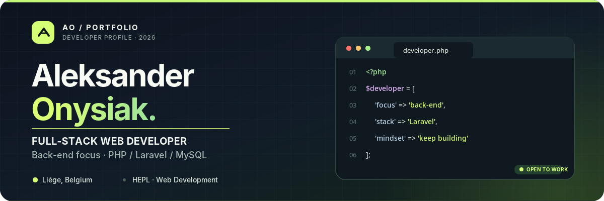
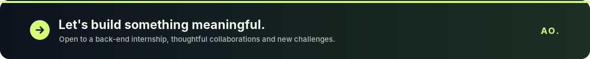

<!--
  GitHub Profile README — Aleksander Onysiak
-->

  

  
  
  

  <strong>Clean architecture. Thoughtful design. Constant learning.</strong> 
  Building practical web applications, with particular attention to the logic behind the interface.

---

### 01 / About me

I'm **Aleksander Onysiak**, a web developer with a background in web development at **HEPL (Haute École de la Province de Liège), Belgium**, and a strong interest in **back-end engineering**.

My preferred tools are **PHP, Laravel and MySQL**. I enjoy turning real requirements into well-structured applications: designing relational databases, implementing business logic, managing authentication and connecting the back end to a usable interface. My graphic design background helps me approach products from both an **engineering** and a **user experience** perspective.

<table>
  <tr>
    <td width="33%" valign="top">
      <b>🎯 Career direction</b>  
      Back-end web development, with a focus on Laravel and PHP.
    </td>
    <td width="33%" valign="top">
      <b>🎓 Right now</b>  
      Developing practical web projects and continuing to strengthen my full-stack skills.
    </td>
    <td width="34%" valign="top">
      <b>🤝 Opportunities</b>  
      Interested in a back-end internship and collaborative projects.
    </td>
  </tr>
</table>

### 02 / Education & training

<table>
  <tr>
    <td width="50%" valign="top">
      <b>HEPL — Web Development &amp; Digital Design</b> 
      <i>4 years of higher education · Degree not obtained</i> 
      <small>Haute École de la Province de Liège</small>
    </td>
    <td width="50%" valign="top">
      <b><a href="https://formation-web-developer-designer.be/">EAFC Fléron–Charlemagne</a></b> 
      Web Developer (BES) · <i>Training under consideration</i>
    </td>
  </tr>
</table>

### 03 / Tech stack

**Core back-end** — my main area of interest

  

**Front-end & web** — building responsive interfaces

  

**Mobile, design & workflow** — connecting code with creative thinking

  

  
<b>More tools and disciplines</b>

   
  Blade templates · Eloquent ORM · Database migrations · Tailwind CSS · Responsive design · Adobe InDesign · Adobe Premiere Pro · Adobe XD · Markdown · Notion

### 04 / Selected projects

<table>
  <tr>
    <td width="50%" valign="top">
      <h3>01 · Cosmunity</h3>
      
<b>Final-year project · In development</b>

      
A community platform for the cosplay world, bringing together creators, photographers and event participants through profiles, groups, events and communication features.

      
<code>Web platform</code> <code>Community</code> <code>Product design</code>

      
<i>Private / work in progress</i>

    </td>
    <td width="50%" valign="top">
      <h3>02 · Metal Guard Belgique</h3>
      
<b>Professional website · Live</b>

      
A real-world web and digital presence project combining WordPress development, a custom theme, content management and a commercial use case.

      
<code>WordPress</code> <code>PHP</code> <code>SCSS</code>

      
<a href="https://metalguard.be/">Visit the website ↗</a>

    </td>
  </tr>
  <tr>
    <td colspan="2" valign="top">
      <h3>03 · Yoga App</h3>
      
<b>Flutter mobile application · In development</b>

      
A Flutter mobile application that lets users join live yoga classes with a coach and follow a variety of structured yoga course plans.

      
<code>Flutter</code> <code>Dart</code> <code>Mobile app</code>

      
<i>Project in progress</i>

    </td>
  </tr>
</table>

  <a href="https://portfolio.aleksanderonysiak.be/mes-projets/"><b>Explore more work on my portfolio →</b></a>

### 05 / What I'm focusing on

- **Back-end engineering:** improving my Laravel architecture, database modeling, relationships and application logic.
- **Code quality:** writing clearer, maintainable code and building confidence with testing and debugging.
- **Full-stack delivery:** connecting reliable PHP back ends with well-designed interfaces.
- **Continuous learning:** developing my JavaScript, TypeScript and Flutter skills alongside my primary stack.

### 06 / Beyond the code

A curious mind with interests in **history, cosplay, technology and visual design**. I value creativity, perseverance and the satisfaction of making complex things work simply.

**Languages:** Polish · French · English

### 07 / Let's connect

If you're looking for a motivated developer interested in **Laravel / PHP back-end development**, I'd be happy to talk about an internship or an interesting project.

  
  

  

Designed with purpose · Built with Markdown, HTML &amp; SVG · © Aleksander Onysiak

